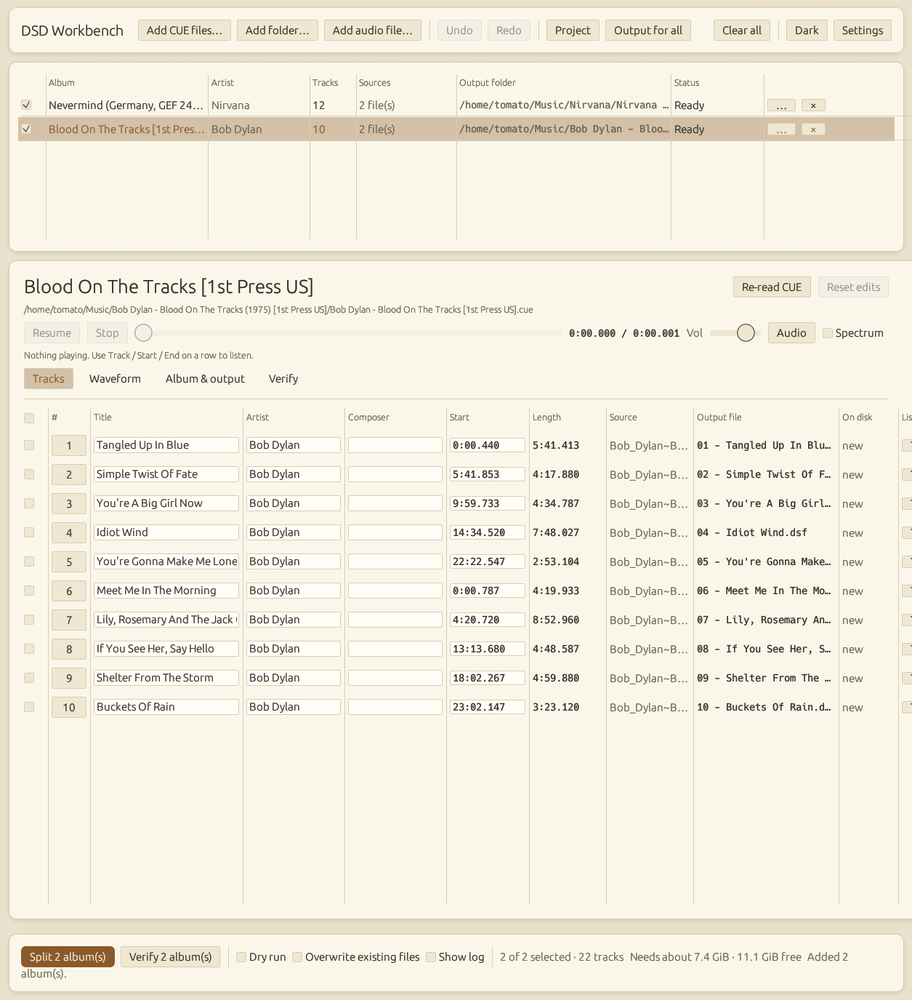
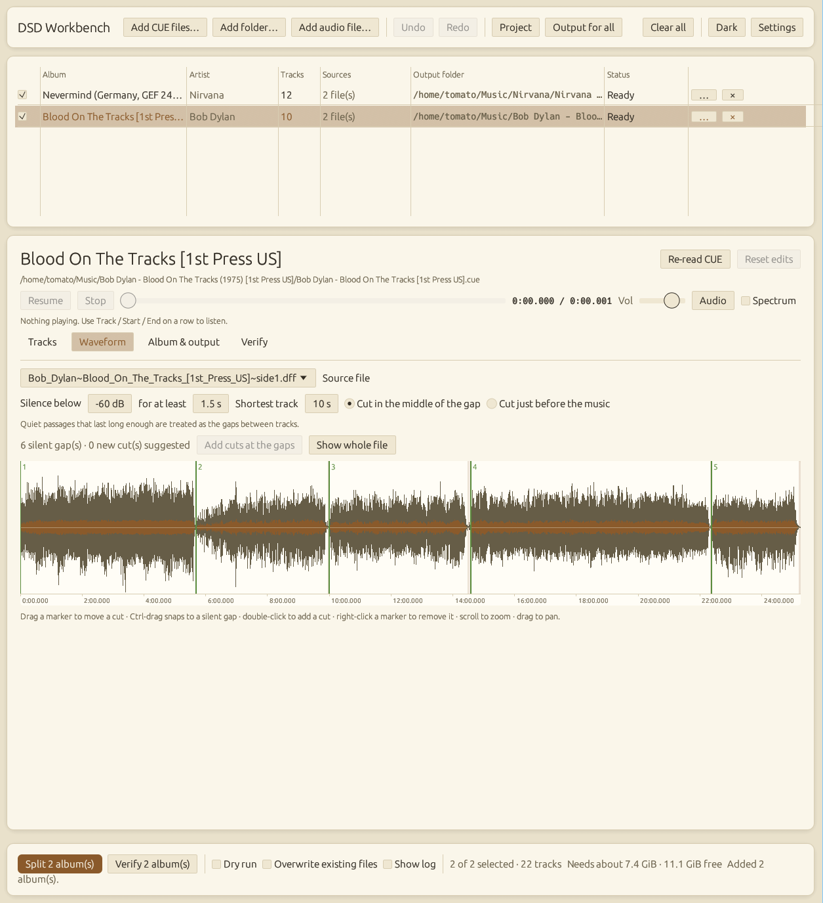
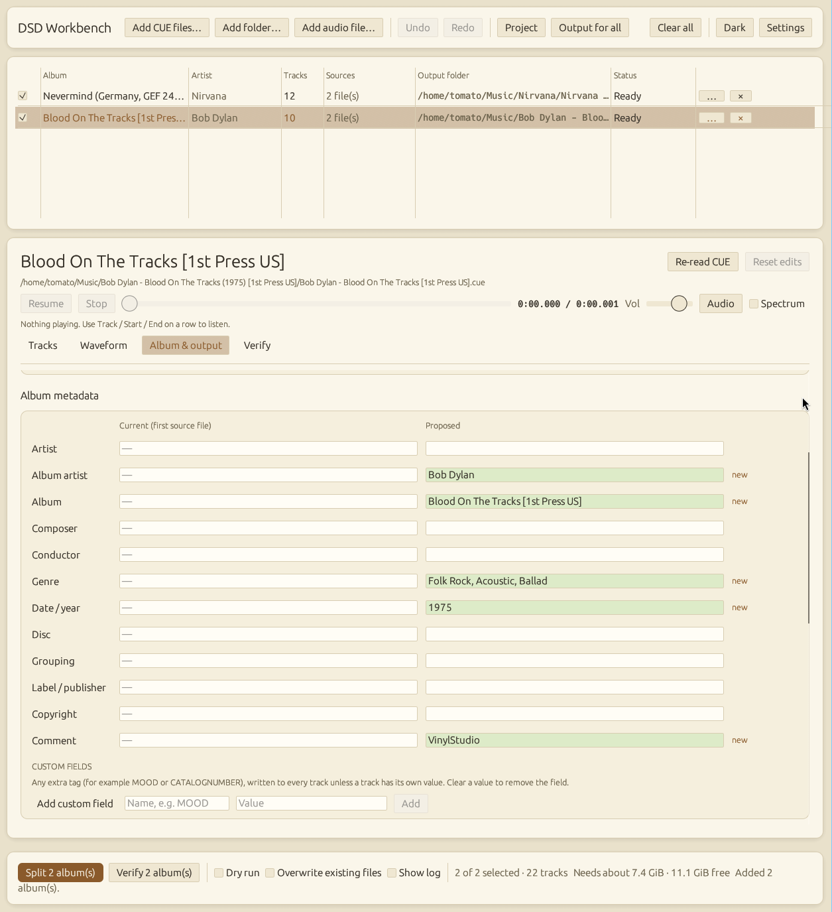

# DSD Workbench

**Split whole-side DSD files into tracks without ever decoding the audio, and prove the result is bit-for-bit identical.**

If you rip SACDs or record vinyl to DSD, you probably end up with one big `.dsf` (or `.dff`) per side and a CUE sheet. Most tools either decode to PCM to cut it (defeating the point of DSD) or can't tell you whether the cut was clean. This one cuts the 1-bit stream directly, to the exact sample, and then reads every new file back and compares it with the source.



<table>
  <tr>
    <td width="50%"></td>
    <td width="50%"></td>
  </tr>
  <tr>
    <td align="center"><sub>Cut by silence or by hand on a zoomable waveform</sub></td>
    <td align="center"><sub>See what will change in the tags before anything is written</sub></td>
  </tr>
</table>

## What it does

- **Bit-perfect, sample-accurate cuts.** DSF and DSDIFF (`.dff`) in, standards-conforming DSF out. Mono, stereo and multichannel; any DSD rate. Cuts land on the exact sample, even off a byte boundary.
- **Proof, not trust.** *Verify* re-reads every output and compares it bit by bit, maps where any difference is, detects a shifted-but-correct file, and checks the tags and cover. `--verify` gives scripts a real exit code.
- **Split files with no CUE sheet.** Find the silent gaps automatically, or place cuts by hand on a zoomable waveform with draggable markers (Ctrl-drag snaps to a gap, loud cuts are flagged). Export the result as a CUE sheet.
- **Real tagging.** Album defaults, per-track overrides, bulk editing, 14 standard fields plus any custom field, cover art (found next to the CUE and embedded), and a *tag-only* mode that fixes tags on files you already have, never touching the audio.
- **Names the way you want.** Templates like `{track:02} - {title}` and `{albumartist}/{album} ({year})`, safe on Windows, macOS and Linux, with non-Latin titles kept intact.
- **Forgiving about CUE sheets.** Wrong case, `.wav` where the file is `.dsf`, Windows paths, Shift-JIS/UTF-16 text, pregaps and hidden tracks, ISRC/catalogue/comment/disc number.
- **Batch workspace, projects and undo.** Add many albums, review everything, save the whole session, undo and redo.
- **Audition before you cut.** Play either side of any cut from the app.
- **GUI and CLI share one engine.**

See [docs/FEATURES.md](docs/FEATURES.md) for the full list.

## Safe by design

- Source files and CUE sheets are **never modified**.
- Existing files are **never replaced** unless you allow it.
- Every track is written to a temporary file and moved into place only when it is complete.
- Free space, write access and path limits are checked before anything starts.
- **Offline. No telemetry. No accounts.** Nothing leaves your computer.

## Quick start

```sh
cargo run -p dsd-workbench --release                                  # open the app
cargo run -p dsd-workbench --release -- album.cue --verify            # split and prove it
cargo run -p dsd-workbench --release -- live.dsf --auto --out out     # no CUE: cut at the silences
```

Requires Rust 1.88 or newer. On Linux the audio output needs the ALSA development files (`libasound2-dev` on Debian/Ubuntu).

## Honest limits

- **DST-compressed files are not supported** (the app says so and explains what to do). Most SACD rip tools can export uncompressed DSD.
- DSDIFF input is uncompressed only. Output is always DSF.
- Silence detection assumes the gaps between tracks are quiet. A gapless live album stays one track unless you place the cuts yourself.
- Audition playback is stereo, at audition quality, not a reference DAC path.
- It has been tested with generated test files, not yet across a wide range of real-world rips and players. Please report anything odd (the app can copy a diagnostics report for you).

## Documentation

Start at [docs/README.md](docs/README.md): [concepts](docs/concepts.md), the [user guide](docs/user-guide.md), the [CLI reference](docs/cli.md), [splitting without a CUE](docs/splitting-without-a-cue.md), [metadata](docs/metadata.md), [file names](docs/naming.md) and [verification](docs/verification.md).

| Part | What it is |
|------|------------|
| [`crates/dsf`](crates/dsf) | Library: DSF header parsing and ID3v2 tag read/write (text, custom, comment, cover). No UI, no CUE knowledge. |
| [`crates/dsdiff`](crates/dsdiff) | Library: DSDIFF header parsing. |
| [`crates/release-lookup`](crates/release-lookup) | Library: find a release on MusicBrainz or Discogs and read its track list. Independent of everything else here; the HTTP client is an optional feature. |
| [`apps/dsd-workbench`](apps/dsd-workbench) | The app and command-line tool. |
| [`site`](site) | The project website (static; deployed to GitHub Pages). |

## License

MIT. See [LICENSE-MIT](LICENSE-MIT).
