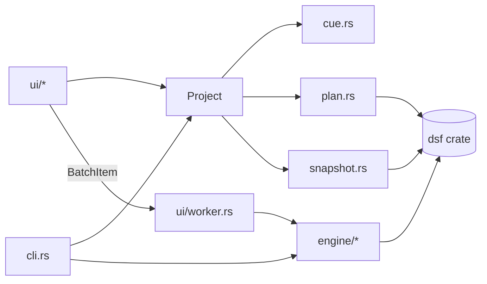

# Architecture

## Overview

Three crates in a Cargo workspace:

- **`dsf`**: format knowledge. Knows nothing about CUE, albums or UIs.
- **`dsdiff`**: (DSDIFF header parsing)
- **`release-lookup`**: MusicBrainz and Discogs request builders and parsers behind a
  source-neutral `Release` model. No dependency on `dsf` or the app; the app enables its
  `http` feature only in `online` builds.
- **`dsd-workbench`**: product logic. Depends on `dsf`; GUI and CLI share one core.

## `dsf` crate

| Module | Role |
|--------|------|
| `header` | `DsfHeader` read/write/validate; `AUDIO_OFFSET`. |
| `storage` | Sealed `Storage` trait (`File`, `Cursor<Vec<u8>>`) so everything is testable in memory. |
| `tag` | `read_tag`, `update_tag`, `write_tag`, `remove_tag` plus `*_path` helpers. |
| `edit` | `TagEdit` (per-frame Set/Clear patches, user text, comment, cover), validated `FrameId`, `WriteOptions`. |
| `field` | `Field` (the common track fields) with the frame each lives in and legacy-frame fallbacks, `Track` (`n/total`), read helpers. Format knowledge only. |
| `error` | `Error` (`#[non_exhaustive]`, `thiserror`). |

Design rules: no panics, no `unsafe`, edits are patches, a corrupt tag is an error, `id3` is re-exported.

## `dsd-workbench` app

| Module | Role |
|--------|------|
| `cue` | CUE text → `CueSheet` (+ warnings). Pure. |
| `plan` | `SplitPlan`: album/track metadata, derived lengths, validation, file naming, the tags to write. Pure. |
| `snapshot` | Read-only disk views: source probing (`SourceInfo`), tag snapshots, `TagCache`. |
| `project` | `Project` and `Entry` (album): CUE loading, output folders, per-album and cross-album validation, folder scanning. UI-free. |
| `timecode` | Parse/format editable times. |
| `engine` | Executes one plan: `splitter` (orchestration, atomic writes, events), `slice` (sample arithmetic), `bits` (bit shifting), `copy` (streaming re-blocking). |
| `cli` | Argument parsing; builds a `Project`, validates, runs engines sequentially. |
| `ui` | `mod` (app state, layout), `albums` and `detail` (grids), `cells`/`widgets`/`theme`, `worker` (background thread). |
| `error` | App `Error`, wrapping `dsf::Error` with context. |
| `audio` | DSD→PCM (`filter`, `stream`), settings, output and transport (`player`, `rodio`), spectrum (`fft`, `spectrum`). |
| `engine::verify` | Reads source and output, compares bit by bit, builds per-slice heat and level data, header/tag checks, and offset search. Pure over `DsdSource`; unit-tested with synthetic files. |
| `disk` | Free-space grouping and write probes before a run. |
| `diag` | In-memory log, panic hook, crash reports, diagnostics text. |
| `settings` | Persisted app settings (`key=value` file). |
| `metadata` | The editable tag model: standard fields (mapped 1:1 to `dsf::Field`, adding labels, project-file ids and per-track-only rules) plus custom `TXXX` keys, and `Fields` maps. An album holds defaults; each track holds only its overrides. It knows nothing about ID3 frames. |
| `naming` | File/folder name templates and filesystem-safe sanitising. Pure. |
| `locate` | Resolves a CUE `FILE` name to the real file (case, extension swap, Windows paths). |
| `cover` | Finds and loads the album cover image. |
| `cue_write` | Writes a plan back as a CUE sheet. |
| `project_file` | Versioned JSON save/load of the album list and all edits. |
| `analysis` | Loudness envelope of a source file, silence detection, cut suggestion and snapping. |
| `meter` | Throughput and time-remaining estimates; weighted batch progress. Clock-free. |
| `history` | Debounced snapshot undo/redo. Clock-free. |
| `selection` | Click/Ctrl/Shift row selection rules. |
| `engine::tagonly` | Applies a plan's tags to existing `.dsf` files without splitting. |
| `ui::fields`, `ui::waveform`, `ui::wave_view`, `ui::analysis_job`, `ui::fonts` | Metadata editors, the waveform widget (with pure geometry), its tab and background analysis, and the CJK font fallback. |

## Data flow

**Add:** path → `Project::add` (canonicalise, reject duplicates) → `CueParser` → `SplitPlan::from_cue` → probe sources → seed blank album fields from the first source's tags → `Entry` (keeps `original` and a working `plan`).

**Edit:** the GUI mutates `Entry::plan` only. `Entry::problems` and `Project::validate` run every frame (cheap; no I/O except cached tag reads).

**Run:** enabled entries → one `SplitEngine` each (cloned plan, output dir, flags) → `Job::spawn` → worker thread runs them in order.

**Per track (`engine`):** validate plan → check target conflicts → `slice::compute` → create `<target>.part` → write header → `copy_slice` → tag via `dsf::update_path` → rename into place; on any error remove the `.part`.

## Concurrency

The UI thread owns the `Project`. The worker owns the engines it was given and shares nothing mutable with the UI. Communication:

- worker → UI: `mpsc` messages `Started`, `Event`, `Done`, `Finished`, `WorkerStopped`, each followed by `ctx.request_repaint()`;
- UI → worker: one `AtomicBool` for cancel, checked between tracks.

**Playback:** the UI sends commands to a dedicated audio thread, which owns the output device, opens files and builds filters, and publishes a small snapshot (state, position source, errors) the UI reads each frame. That thread starts a decoder thread feeding a bounded queue; the audio callback only reads it (silence on underrun). Spectrum samples go through a `try_lock`ed ring buffer.

The UI drains messages once per frame (`poll_job`) and updates `RunState`. The albums grid and detail card are disabled while a job runs.

## Validation layers

1. `SplitPlan::validate`: numbers, start times, lengths, duplicate target names within an album.
2. `Entry::problems`: adds output folder, source health, start beyond end, overwriting a source.
3. `Project::validate`: adds cross-album output collisions.
4. `engine::execute`: re-validates the plan and refuses existing targets unless overwrite is set. The engine never trusts the caller.

## Error handling

Typed errors end to end; no `unwrap`/`expect` outside tests. I/O errors carry context (`Error::io("...")`). The UI shows `Display` strings; the CLI prints them and sets the exit code.

## Testing

| Level | Where |
|-------|-------|
| Format and tags | `dsf` unit tests on `Cursor<Vec<u8>>`. |
| Pure logic | `cue`, `plan`, `timecode`, `engine::slice`, `engine::bits`. |
| Bit-exactness | `engine::copy`: every sample compared to a reference, both bit orders, many offsets. |
| End to end | `engine::splitter`: synthetic DSF → split → tags and header checked → overwrite refused. |

The GUI has no automated tests; keep logic out of `ui/`.

## Decisions

- **Plan vs CUE:** the CUE sheet is input only; edits are never written back.
- **Atomic output via `.part`:** finished files are never half-written.
- **Domain-agnostic `dsf` crate:** keeps it publishable and reusable (for example by a tagger).
- **One engine per album:** simple cancellation and failure isolation.

